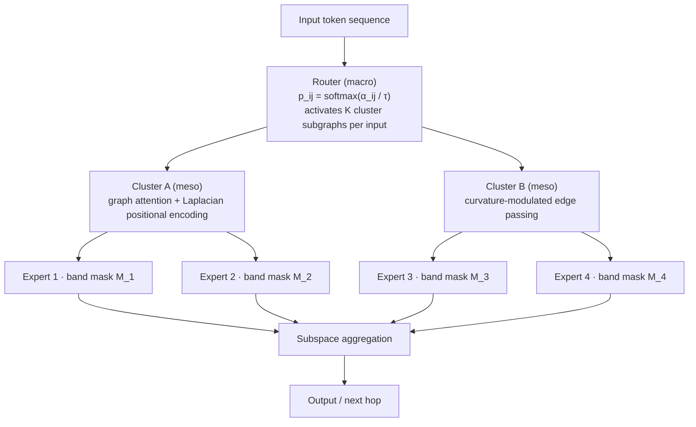

# NST · Neuro-Sphere Transformer

**Growing Topology · Non-Interfering Memory · Continual Online Learning**

> **One-sentence positioning**: replace fixed layers with **differentiable graph growth**, replace global rewriting with **orthogonal subspaces**, and replace dense computation with **sparse activation** — applying constraints on all three axes of *structure, knowledge, and compute* at once, in exchange for high capacity and low forgetting in continual-learning settings.

---

## 0 · Read in three minutes

Today's Transformer quietly accepts three hard constraints. NST removes them one by one:

| # | Hard constraint of the current paradigm | Consequence | NST's answer |
|---|---|---|---|
| P1 | Layer count and connectivity are hand-designed | Capacity mismatches the task; changing structure means retraining | Topology becomes a learnable parameter that grows with data |
| P2 | Fully shared parameters; every new task rewrites the whole model | New knowledge corrupts old knowledge (catastrophic forgetting) | Experts isolated in frequency-domain subspaces; gradients projected onto local bands only |
| P3 | Fixed inference path, dense computation | Hard and easy samples cost the same | Router activates a subgraph per input — two-level sparsity |

> Current status: **concept & design stage (Pre-MVP)**. This repository publishes the design document first. Every core mechanism is built on a single technique that already exists in the literature (DARTS, MoE, Graph Transformers, continual learning); the *combination* has not yet been validated by large-scale experiments. For an honest way to evaluate it, see [Section 10](#10--honest-disclosure-what-this-repository-is-and-is-not).

---

## 1 · Design philosophy: engineering the brain's anti-forgetting mechanisms

The human brain keeps learning for decades without forgetting — not because it is "bigger" or "slower", but because of three structural mechanisms repeatedly confirmed by neuroscience:

1. **Neurogenesis**: the adult hippocampal dentate gyrus keeps producing new neurons. New information is written into new cells instead of overwriting old ones.
2. **Pattern separation**: the dentate gyrus encodes similar inputs into mutually orthogonal representations, preventing interference between new and old memories at the source.
3. **Consolidation via replay**: during sleep, the hippocampus replays important memories from the day and gradually consolidates them into the neocortex.

NST's approach: map these three facts **one-to-one onto structural constraints** — growing topology = neurogenesis, orthogonal experts = pattern separation, replay + staged consolidation = sleep consolidation. That is the entire basis for the "continual online learning" claim; Section 4 gives the row-by-row mapping table.

> **An honest statement about "closest to the human brain"**: this document claims that *at the structural level we introduce three classes of constraints that correspond directly to confirmed neural mechanisms*. This is an **analogy in inductive bias**, not an unfalsifiable scientific conclusion like "we proved the model is brain-like". Worded this way, the claim keeps its force without being killed by a single question in peer review or open-source discussions.

**Design goals (ordered by verifiability)**

| # | Goal | Where it lands |
|---|---|---|
| G1 | Structural adaptivity | Topology grows with data and tasks; capacity matches the task |
| G2 | Forgetting resistance | New/old knowledge live in isolated subspaces; old-task drop ≤ δ |
| G3 | Inference efficiency | Top-K subgraph + expert sparsity, two levels; FLOPs in the same order as a dense baseline |
| G4 | Continual online learning | When a new task arrives: **no global retraining, no full old data** — only grow new experts + tiny replay |

---

## 2 · Architecture overview: three nested levels + one directed graph

| Level | Unit | Responsibility | Update frequency |
|---|---|---|---|
| Macro | Neural-cluster nodes, edge weights α | Decides "where information may go" | Low (frozen after search phase) |
| Meso | Intra-cluster graph attention + positional encoding | Decides "how information is fused" | Medium |
| Micro | Frequency-domain orthogonal experts | Decides "where knowledge is stored" | High (new knowledge only touches here) |

**Interface contract (fix this before writing any code, or the engineering will drift)**: `d_model` (model dimension), `C` (number of clusters), `K` (clusters activated per input), `E` (experts per cluster), `B` (number of frequency bands), `G_max` (maximum growth steps).

---

## 3 · Three core mechanisms

### 3.1 Differentiable topology growth (macro)

- Edge weights `α_ij` route information through the soft router `p_ij = softmax_j(α_ij / τ)`; temperature `τ` anneals from 1 down to 0.1, realizing "explore → commit".
- Bilevel optimization: inner loop learns parameters `w`, outer loop learns topology `α`, using a first-order approximation to avoid the memory and time cost of second-order Hessians.
- Discretization: prune by threshold `τ_prune` and keep the Top-K outgoing edges per node; **retraining after pruning is mandatory** to close the discretization gap between the search phase and inference.
- Regularization: topology entropy `H(p)` penalty prevents all of α from collapsing onto a single edge.

### 3.2 Graph-aware attention (meso)

- **Laplacian positional encoding**: take the first `k` non-trivial eigenvectors of the graph Laplacian as the positional signal; random sign flipping at training time serves as data augmentation against the sign ambiguity of eigenvectors.
- **Curvature modulation**: edge passing coefficient `exp(-λ·κ_ij)`, where `κ` is a discrete Ollivier-Ricci curvature estimate — positive curvature marks tight intra-cluster edges (fast lanes), negative curvature marks bridging edges (controlled release), geometrically distinguishing "internal fusion" from "cross-cluster jumps".
- **Complexity control**: token↔token uses a local window; token↔cluster-centroid uses global cross-attention — overall `O(N·K·d)` instead of dense `O(N²)`.

### 3.3 Frequency-domain orthogonal experts (micro) — the mathematical landing point of pattern separation

- Each expert is bound to a band mask `M_b ∈ {0,1}^d` (a support set under the DCT/FFT basis).
- Forward: `h' = h + M_b ⊙ W_b h`; routing is top-1/top-2 with a capacity factor and a load-balancing loss.
- Backward: gradients are projected through `M_b`, **updating only that frequency-band subspace** — mathematically, a new task's signal flow cannot write into the bands occupied by old tasks. This is where "local updates, zero interference" actually lands.
- A strictness note: bands are strictly orthogonal only when their **support sets are disjoint**; if capacity forces overlaps, a projection matrix must be introduced and `‖P_i P_j‖ < ε` verified. This condition will be a fixed check in every ablation experiment.

### 3.4 Growth and consolidation

- **New experts**: orthogonal initialization + small-norm start + cosine-similarity constraint against the nearest existing expert (prevents redundant growth).
- **Capacity budget**: a hard cap on total parameters; exceeding it triggers recycling — "merge the most similar experts / prune the least activated ones".
- **Snapshots**: checkpoint before every growth step; anomalies roll back.

---

## 4 · Mapping to neuroscience mechanisms

This is the core claim table of this proposal — every row is "a mechanism confirmed in the brain → a structural constraint in NST":

| Neural mechanism (with literature support) | Role in the brain | Engineering counterpart in NST |
|---|---|---|
| Adult hippocampal neurogenesis | New neurons encode new information without disturbing old memories | New experts and edges grown on demand |
| Dentate-gyrus pattern separation | Similar inputs get orthogonalized; interference prevented at the source | Orthogonal frequency subspaces + gradient projection |
| Sleep replay & memory consolidation | Hippocampus replays old memories, gradually consolidating into cortex | Small replay buffer + S2 distillation consolidation |
| Sparse coding in cortex | Few neurons respond; extremely low energy cost | Top-K subgraph + sparse expert activation |
| Synaptic pruning | Use it or lose it; invalid connections removed | Pruning + recycling of low-activation experts |
| Neuromodulation | Tunes the balance between exploration and exploitation | Temperature annealing τ + growth trigger conditions |

---

## 5 · Why this structure supports "continual online learning"

The classic deadlock of online learning: when a new task arrives, untouched parameters cannot learn it, but touched parameters forget the old ones. NST splits this path into four segments, each with its own mechanism, instead of brute-forcing it with a bigger replay set:

1. **New knowledge has a dedicated new home**: growth is triggered, new experts learn from orthogonal initialization and naturally do not overlap old ones (neurogenesis).
2. **Old knowledge is physically untouchable**: frozen backbone + gradient projection; backprop signals are blocked outside the old subspaces by the band masks (pattern separation).
3. **Old knowledge survives on tiny replay only**: a ~1% replay buffer, mirroring the fact that the brain does not replay all memories — only high-value samples (sleep consolidation).
4. **Per-step cost is decoupled from task scale**: during the online phase, the only trainable parameters are the new experts, so training cost is `O(increment)`, not `O(whole model)`.

Acceptance criterion in one sentence: **on a task sequence, BWT ≥ 0 (non-negative backward transfer), old-task drop ≤ δ, while the new task reaches at least 95% of single-task training performance.**

---

## 6 · Comparison under equal conditions

| Dimension | Standard Transformer | Sparse MoE | Graph neural networks | PEFT/LoRA | **NST** |
|---|---|---|---|---|---|
| Structural adaptivity | ✗ fixed | Partial (expert count fixed) | ✗ graph given | ✗ | ✓ growable topology |
| Forgetting resistance | ✗ | Weak (shared routing) | ✗ | Medium | ✓ orthogonal isolation |
| Inference sparsity | ✗ dense | ✓ | Partial | ✗ | ✓ subgraph + expert, two-level sparsity |
| Long-range modeling | Medium (O(N²)) | Medium | Strong (topological prior) | Weak | Strong (global graph wandering) |
| Engineering complexity | Low | Medium | Medium | Low | **High (acknowledged openly)** |

**Honest handling of the narrative**: the advantage table only holds under "same task, same parameter budget, same training budget" — and that is a mandatory requirement of the experiment design in Section 9. The bio-inspired positioning is phrased as "three classes of bio-inspired structural constraints are introduced", never as an assertion of being "more brain-like".

---

## 7 · Training pipeline: four stages

| Stage | What happens | Trainable | Budget | Pass criterion |
|---|---|---|---|---|
| S0 Warm-up | Fixed initial topology; train experts and attention | `w` | Small | Converges, no NaN |
| S1 Search | Jointly optimize parameters and topology | `w, α` | Medium | Topology entropy drops, healthy activation rate |
| S2 Consolidation | Prune + retrain + EMA teacher distillation | `w` | Medium | Post-pruning drop < 1% |
| S3 Online | Freeze backbone; only open new experts + small replay | New experts | Very low | BWT ≥ 0, old-task drop < δ |

---

## 8 · Assurance system

Principle: **any guarantee that "holds in theory" must be paired with a metric that "can be measured in practice" — otherwise it does not go into the claims.**

| Guarantee | Mechanism (defense in depth) | Acceptance metric |
|---|---|---|
| Controllable forgetting | Backbone freeze + frequency-domain gradient projection + 1% replay | BWT / old-task accuracy drop ≤ δ |
| Training stability | Temperature annealing + gradient clipping + topology entropy regularization + collapse detector | No mode collapse; α-distribution entropy > threshold |
| Controllable compute | Top-K activation + capacity factor + blocked frequency-domain parallelism | Peak memory ≤ budget; FLOPs in the same order as a dense baseline |
| Reproducibility | Fixed search space + frozen seeds and data order + full logging | Metric difference between two runs < noise band |
| Rollback | Snapshot before growth + automatic anomaly rollback + dense fallback mode | Service uninterrupted under failure |

---

## 9 · Experiment design and milestones

- **Tasks**: ① language modeling (long context); ② task-sequence continual learning (5–10 downstream tasks arriving sequentially); ③ graph / molecular tasks (to validate the topological prior).
- **Metrics**: PPL / task accuracy, BWT (backward transfer), FWT (forward transfer), activation rate, expert utilization, peak memory, throughput.
- **Ablations (none may be skipped)**: remove topology search, remove orthogonal masks, remove curvature, remove growth, remove replay — run each one.
- **Baselines**: dense Transformer, Switch / Mixtral-style MoE, sequential LoRA fine-tuning, EWC / SI-style regularization methods.

| Milestone | Content | Acceptance |
|---|---|---|
| M1 (2–3 weeks) MVP | Small graph + 2 experts + single task, end-to-end | Validates "it can train": forward/backward without NaN, loss decreases |
| M2 (4–6 weeks) mechanism validation | Add growth and orthogonal projection, 3-task sequence | Observe BWT ≥ 0 |
| M3 (6–8 weeks) scaling | Medium scale, full ablations and baseline comparisons | Every cell of the advantage table backed by data |
| M4 | Paper skeleton + minimal open-source implementation | Documentation, code, experiments — the full trio |

**MVP starting configuration**: `C=8`, `E=2`, single-layer graph attention — get it running first, then talk about scale.

---

## 10 · Honest disclosure: what this repository is and is not

**What it is**: a research design document with explicit acceptance criteria; an architecture proposal that recombines three mature single-point techniques (differentiable search, MoE, graph attention) along the "anti-forgetting" axis; a set of hypotheses that can be quickly falsified with the M1 minimal prototype.

**What it is not**: not an already-trained model; not a claim that "brain-likeness" is a scientific conclusion; not validated by large-scale compute; the engineering complexity is high (three mechanisms coupled) — this is stated plainly in the comparison table, without gloss.

**Falsification paths (anyone is welcome to run them)**: if M1 fails to converge on toy tasks, or M2's BWT stays negative, or the ablation shows the orthogonal masks contribute nothing to the forgetting metrics — any one of these means the proposal's main claim does not hold. This path is itself part of the repository's value.

---

## 11 · Next steps and contributing

- [ ] M1: PyTorch minimal prototype (graph attention + 2 experts + differentiable edge weights), validate forward/backward on a toy task
- [ ] M2: growth mechanism + orthogonal projection + 3-task sequence, validate BWT
- [ ] Ablation scripts and metric visualization

Open an Issue for discussions; when proposing mechanism improvements, please attach a suggested "acceptance metric" — that is the hard language of this project.

**License**: Apache-2.0 (ship a LICENSE file with the repository when publishing code).

---

## 12 · Paper skeleton (standby)

1. Introduction (three constraints → three mechanisms)
2. Related Work (DARTS / Graph Transformer / MoE / continual learning)
3. Method (3.1–3.4 + the four training stages)
4. Theoretical Analysis (orthogonality conditions, forgetting upper bound, complexity)
5. Experiments (main results + ablations + efficiency)
6. Limitations & Discussion
7. Conclusion

Figure list: Fig.1 three-level architecture diagram｜Fig.2 topology growth visualization｜Fig.3 expert band-partition illustration｜Tab.1 main results｜Tab.2 ablations｜Tab.3 efficiency comparison.

---

## References

**Architecture & search**: Liu et al., *DARTS: Differentiable Architecture Search*, ICLR 2019; Shazeer et al., *Outrageously Large Neural Networks: The Sparsely-Gated Mixture-of-Experts Layer*, ICLR 2017; Fedus et al., *Switch Transformers*, JMLR 2022; Jiang et al., *Mixtral of Experts*, 2024.

**Graph neural networks & geometry**: Rampášek et al., *Recipe for a General, Powerful, Scalable Graph Transformer*, NeurIPS 2022; Dwivedi et al., *Benchmarking Graph Neural Networks*, 2020; Topping et al., *Understanding Over-squashing and Bottlenecks on Graphs via Curvature*, ICLR 2022.

**Continual learning & parameter efficiency**: Kirkpatrick et al., *Overcoming Catastrophic Forgetting in Neural Networks*, PNAS 2017; Mallya & Lazebnik, *PackNet: Adding Multiple Tasks to a Single Network*, CVPR 2018; Rusu et al., *Progressive Neural Networks*, 2016; Hu et al., *LoRA: Low-Rank Adaptation of Large Language Models*, ICLR 2022.

**Frequency-domain methods**: Lee-Thorp et al., *FNet: Mixing Tokens with Fourier Transforms*, NAACL 2022.

**Neuroscience foundations**: Deng et al., *New Neurons and New Memories*, Nature Reviews Neuroscience 2010; Yassa & Stark, *Pattern Separation in the Hippocampus*, Trends in Neurosciences 2011; Wilson & McNaughton, *Reactivation of Hippocampal Ensemble Memories During Sleep*, Science 1994.
