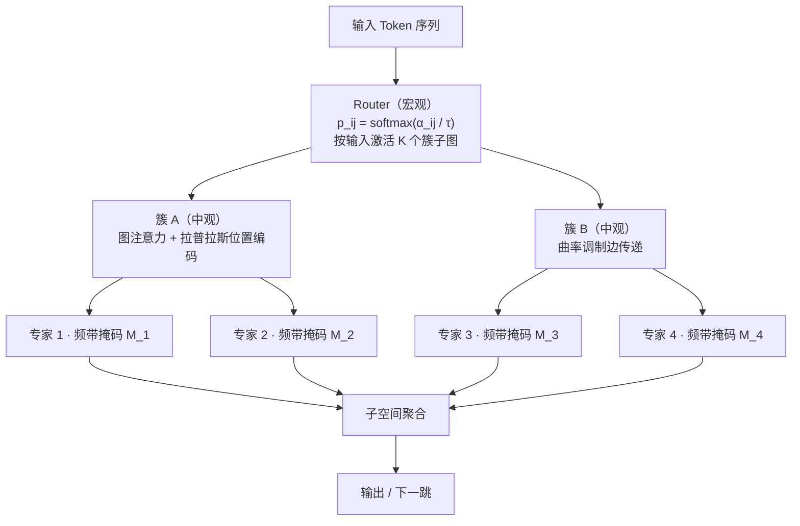

# NST · Neuro-Sphere Transformer

**会生长的拓扑 · 不干扰的记忆 · 持续在线学习**

> **一句话定位**：用**可微图生长**替代固定层级，用**正交子空间**替代全局改写，用**稀疏激活**替代稠密计算——在"结构、知识、算力"三个维度上同时做约束，换取持续学习场景下的高容量与低遗忘。

---

## 0 · 三分钟读完

现有 Transformer 有三个被默认接受的硬约束，NST 逐个拆除：

| # | 现有范式的硬约束 | 后果 | NST 的应对 |
|---|---|---|---|
| P1 | 层数与连接方式人工预设 | 容量与任务不匹配，改结构靠重训 | 拓扑成为可学习参数，随数据生长 |
| P2 | 全参数共享，新任务全局改写 | 新知识污染旧知识（灾难性遗忘） | 专家按频域子空间隔离，梯度定向投影，只更新局部 |
| P3 | 推理路径固定、稠密计算 | 难样本与易样本同代价 | 路由器按输入激活子图，双层稀疏 |

> 当前状态：**概念与设计阶段（Pre-MVP）**。本仓库先公开设计文档，核心机制均基于已有文献的单点技术（DARTS、MoE、图 Transformer、持续学习），组合方案尚未经过大规模实验验证。诚实的评估方式见[第 10 节](#10--诚实声明这份仓库是什么不是什么)。

---

## 1 · 设计思想：把大脑的抗遗忘机制工程化

人类大脑能持续学习数十年而不遗忘，靠的不是"更大"或"更慢"，而是三种被神经科学反复证实的结构性机制：

1. **神经发生（neurogenesis）**：成年海马齿状回仍在产生新神经元，新信息写入新细胞，而不是改写旧细胞。
2. **模式分离（pattern separation）**：齿状回把相似的输入编码成彼此正交的表示，从源头上避免新旧记忆互相干扰。
3. **睡眠巩固（consolidation via replay）**：海马在睡眠中重放白天的重要记忆，逐步固化到新皮层。

NST 的做法：把这三件事**逐一对应成结构约束**——生长拓扑 = 神经发生，正交专家 = 模式分离，回放与分层固化 = 睡眠巩固。这就是"持续在线学习"主张的全部依据，后面第 4 节给出逐条对应表。

> **关于"最接近人脑"的诚实表述**：本文声称的是"结构层面引入了三类与已证实神经机制直接对应的约束"，这是一个**归纳偏置上的类比**，不是"我们证明了类脑"这类无法证伪的科学结论。这样的表述既保留了主张的力度，也不会在审稿或开源社区讨论中被一击致命。

**设计目标（按可验收性排序）**

| 编号 | 目标 | 落点 |
|---|---|---|
| G1 | 结构自适应 | 拓扑随数据与任务生长，容量与任务匹配 |
| G2 | 抗遗忘 | 新旧知识子空间隔离，旧任务掉点 ≤ δ |
| G3 | 推理高效 | Top-K 子图 + 专家双层稀疏，FLOPs 与稠密基线同量级 |
| G4 | 持续在线学习 | 新任务到来时**无全局重训、无全量旧数据**，只生长新专家 + 微量回放 |

---

## 2 · 架构总览：三层嵌套 + 一张有向图

| 层级 | 单元 | 职责 | 更新频率 |
|---|---|---|---|
| 宏观 | 神经簇节点、边权重 α | 决定"信息能去哪" | 低（搜索期结束后冻结） |
| 中观 | 簇内图注意力 + 位置编码 | 决定"信息如何融合" | 中 |
| 微观 | 频域正交专家 | 决定"知识存在哪" | 高（新知识只动这里） |

**接口约定（动工前先定死，否则工程会失控）**：`d_model`（模型维度）、`C`（簇数）、`K`（每输入激活簇数）、`E`（每簇专家数）、`B`（频带划分数）、`G_max`（最大生长步数）。

---

## 3 · 三大核心机制

### 3.1 可微拓扑生长（宏观）

- 边权重 `α_ij` 经软路由 `p_ij = softmax_j(α_ij / τ)` 决定信息流向，温度 `τ` 从 1 退火到 0.1，完成"探索 → 固化"。
- 双层优化：内层学参数 `w`，外层学拓扑 `α`，取一阶近似，避免二阶 Hessian 的显存与时间开销。
- 离散化：按阈值 `τ_prune` 剪枝 + 每节点保留 Top-K 出边；**剪枝后必须重训**，弥合搜索期与推理期之间的离散化鸿沟。
- 正则：拓扑熵 `H(p)` 惩罚，防止 α 全部塌缩到同一条边。

### 3.2 图感知注意力（中观）

- **拉普拉斯位置编码**：取图拉普拉斯的前 `k` 个非平凡特征向量作为位置信号；训练时随机符号翻转做数据增强，缓解特征向量的符号歧义。
- **曲率调制**：边传递系数 `exp(-λ·κ_ij)`，`κ` 为离散 Ollivier-Ricci 曲率估计——正曲率是团簇内紧密边（走快），负曲率是桥接边（受控放行），几何上天然区分"内部融合"与"跨簇跳跃"。
- **复杂度控制**：Token↔Token 用局部窗口，Token↔簇心用全局交叉注意力，总体 `O(N·K·d)` 而非稠密的 `O(N²)`。

### 3.3 频域正交专家（微观）——模式分离的数学落点

- 每个专家绑定一个频带掩码 `M_b ∈ {0,1}^d`（DCT/FFT 基下的支撑集）。
- 前向：`h' = h + M_b ⊙ W_b h`；路由 top-1/top-2 + 容量因子 + 负载均衡损失。
- 反向：梯度经 `M_b` 投影，**只更新该频带子空间**——新任务的信号流在数学上无法写入旧任务占用的频带，这是"局部更新、互不干扰"的落点。
- 严格性提醒：不同频带**支撑集不重叠**才严格正交；若为容量允许重叠，需引入投影矩阵并验证 `‖P_i P_j‖ < ε`。此条件将作为消融实验的固定检查项。

### 3.4 生长与固化

- **新专家**：正交初始化 + 小范数起步 + 与最近邻专家的余弦相似度约束（防止冗余生长）。
- **容量预算**：总参数量设硬上限，超限触发"合并最相似专家 / 剪除低激活专家"的回收机制。
- **快照**：每次生长前存 checkpoint，异常可回滚。

---

## 4 · 与神经科学的机制对应

这是本方案的核心主张表——每一行都是"大脑里被证实的机制 → NST 里的结构约束"：

| 神经机制（有文献支持） | 在大脑中的作用 | NST 的工程对应 |
|---|---|---|
| 成年海马神经发生 | 新神经元编码新信息，不干扰旧记忆 | 新专家、新边按需生长 |
| 齿状回模式分离 | 相似输入被正交化，源头防干扰 | 频域正交子空间 + 梯度投影 |
| 睡眠回放与记忆巩固 | 海马重放旧记忆，逐步固化到皮层 | 小容量回放缓冲 + S2 蒸馏固化 |
| 皮层稀疏编码 | 少数神经元响应，能耗极低 | Top-K 子图 + 专家稀疏激活 |
| 突触修剪 | 用进废退，清除无效连接 | 剪枝 + 低激活专家回收 |
| 神经调质调节 | 调节探索与利用的平衡 | 温度退火 τ + 生长触发条件 |

---

## 5 · 为什么这套结构能"持续在线学习"

在线学习的传统死结：新任务来了，不动参数就学不会，动了参数就忘旧的。NST 把这条路拆成四段，每段都有对应的机制，而不是靠"更大的回放集"硬扛：

1. **新知识有专门的新去处**：触发生长，新专家从正交初始化学起，天然不与旧专家重叠（神经发生）。
2. **旧知识物理上不可被触碰**：骨干冻结 + 梯度投影，反向传播的信号被频带掩码挡在旧子空间之外（模式分离）。
3. **旧知识的"续命"只靠微量重放**：1% 级回放缓冲，对应大脑并不重放全部记忆、只重放高价值样本（睡眠巩固）。
4. **每步代价与任务规模解耦**：在线阶段的可训练参数只有新专家，训练代价是 `O(增量)` 而不是 `O(全模型)`。

验收标准一句话：**任务序列上 BWT ≥ 0（后向迁移非负），旧任务掉点 ≤ δ，同时新任务达到单任务训练 95% 以上的水平。**

---

## 6 · 同条件对比

| 维度 | 标准 Transformer | 稀疏 MoE | 图神经网络 | PEFT/LoRA | **NST** |
|---|---|---|---|---|---|
| 结构自适应 | ✗ 固定 | 部分（专家数固定） | ✗ 图给定 | ✗ | ✓ 拓扑可生长 |
| 抗遗忘 | ✗ | 弱（共享路由） | ✗ | 中 | ✓ 正交隔离 |
| 推理稀疏性 | ✗ 稠密 | ✓ | 部分 | ✗ | ✓ 子图 + 专家双层稀疏 |
| 长程建模 | 中（O(N²)） | 中 | 强（拓扑先验） | 弱 | 强（全局图漫游） |
| 工程复杂度 | 低 | 中 | 中 | 低 | **高（需正视）** |

**叙事上的诚实处理**：优势表只在"同任务、同参数预算、同训练预算"的条件下才成立——这也是第 9 节实验设计的强制要求。生物启发的定位表述为"引入三类生物启发的结构约束"，而非断言"更类脑"。

---

## 7 · 训练流程：四阶段

| 阶段 | 做什么 | 可训练 | 预算 | 通过标准 |
|---|---|---|---|---|
| S0 预热 | 固定初始拓扑，训专家与注意力 | `w` | 小 | 收敛、无 NaN |
| S1 搜索 | 联合优化参数与拓扑 | `w, α` | 中 | 拓扑熵下降、激活率健康 |
| S2 巩固 | 剪枝 + 重训 + EMA 教师蒸馏 | `w` | 中 | 剪枝后掉点 < 1% |
| S3 在线 | 冻结骨干，仅开新专家 + 小回放 | 新专家 | 极低 | BWT ≥ 0、旧任务掉点 < δ |

---

## 8 · 可保障体系

原则：**任何"理论上成立"的保证，都必须配一个"实测能测"的指标，否则不写进主张。**

| 保证类型 | 机制（多重保险） | 验收指标 |
|---|---|---|
| 遗忘可控 | 骨干冻结 + 频域梯度投影 + 1% 回放 | BWT / 旧任务准确率下降 ≤ δ |
| 训练稳定 | 温度退火 + 梯度裁剪 + 拓扑熵正则 + 坍缩检测器 | 无模式坍缩；α 分布熵 > 阈值 |
| 计算可控 | Top-K 激活 + 容量因子 + 分块频域并行 | 峰值显存 ≤ 预算；FLOPs 与稠密基线同量级 |
| 可复现 | 固定搜索空间 + 固化种子与数据顺序 + 全量日志 | 两次运行指标差 < 噪声带 |
| 可回退 | 生长前快照 + 异常自动回滚 + 稠密降级模式 | 故障时服务不中断 |

---

## 9 · 实验设计与里程碑

- **任务**：① 语言建模（长上下文）；② 任务序列持续学习（5–10 个下游任务顺序到来）；③ 图 / 分子任务（验证拓扑先验）。
- **指标**：PPL / 任务准确率、BWT（后向迁移）、FWT（前向迁移）、激活率、专家利用率、峰值显存、吞吐。
- **消融（缺一不可）**：去拓扑搜索、去正交掩码、去曲率、去生长、去回放，各跑一遍。
- **基线**：稠密 Transformer、Switch / Mixtral 式 MoE、LoRA 顺序微调、EWC / SI 类正则方法。

| 里程碑 | 内容 | 验收 |
|---|---|---|
| M1（2–3 周）MVP | 小规模图 + 2 专家 + 单任务，端到端跑通 | 验证"能训练"：前向 / 反向无 NaN，损失下降 |
| M2（4–6 周）机制验证 | 加入生长与正交投影，3 任务序列 | 看到 BWT ≥ 0 |
| M3（6–8 周）规模化 | 中等规模，完整消融与基线对比 | 优势表逐格有数据支撑 |
| M4 | 论文骨架 + 开源最小实现 | 文档、代码、实验三件套齐备 |

**MVP 起步配置**：`C=8`、`E=2`、单层图注意力——先跑通，再谈规模。

---

## 10 · 诚实声明：这份仓库是什么、不是什么

**是什么**：一份有明确验收标准的研究设计文档；一个把三项成熟单点技术（可微搜索、MoE、图注意力）按"抗遗忘"主线重新组合的架构提案；一个可以用 M1 的最小原型快速证伪的假设集合。

**不是什么**：不是一个已经训练好的模型；不声称"类脑"是科学结论；没有大规模算力验证；工程复杂度高（三套机制耦合），这一点在对比表中如实标注，不粉饰。

**证伪路径（欢迎任何人执行）**：如果 M1 无法在 toy 任务上收敛，或 M2 的 BWT 持续为负，或消融显示正交掩码对遗忘指标无贡献——任一成立，则本方案的主要主张不成立。这条路径本身就是这个仓库的价值之一。

---

## 11 · 下一步与贡献

- [ ] M1：PyTorch 最小原型（图注意力 + 2 专家 + 可微边权重），toy 任务验证前向 / 反向
- [ ] M2：生长机制 + 正交投影 + 3 任务序列，验证 BWT
- [ ] 消融脚本与指标可视化

讨论请开 Issue；提出机制改进时，请附上"验收指标"建议——这是本项目的硬性语言。

**License**：Apache-2.0（发布代码时随仓库附上 LICENSE 文件）。

---

## 12 · 论文骨架（备用）

1. Introduction（三条约束 → 三个机制）
2. Related Work（DARTS / Graph Transformer / MoE / 持续学习）
3. Method（3.1–3.4 + 训练四阶段）
4. Theoretical Analysis（正交性条件、遗忘上界、复杂度）
5. Experiments（主实验 + 消融 + 效率）
6. Limitations & Discussion
7. Conclusion

图表清单：Fig.1 三层架构图｜Fig.2 拓扑生长过程可视化｜Fig.3 专家频带划分示意｜Tab.1 主结果｜Tab.2 消融｜Tab.3 效率对比。

---

## 参考工作

**架构与搜索**：Liu et al., *DARTS: Differentiable Architecture Search*, ICLR 2019；Shazeer et al., *Outrageously Large Neural Networks: The Sparsely-Gated Mixture-of-Experts Layer*, ICLR 2017；Fedus et al., *Switch Transformers*, JMLR 2022；Jiang et al., *Mixtral of Experts*, 2024。

**图神经网络与几何**：Rampášek et al., *Recipe for a General, Powerful, Scalable Graph Transformer*, NeurIPS 2022；Dwivedi et al., *Benchmarking Graph Neural Networks*, 2020；Topping et al., *Understanding Over-squashing and Bottlenecks on Graphs via Curvature*, ICLR 2022。

**持续学习与参数高效**：Kirkpatrick et al., *Overcoming Catastrophic Forgetting in Neural Networks*, PNAS 2017；Mallya & Lazebnik, *PackNet: Adding Multiple Tasks to a Single Network*, CVPR 2018；Rusu et al., *Progressive Neural Networks*, 2016；Hu et al., *LoRA: Low-Rank Adaptation of Large Language Models*, ICLR 2022。

**频域方法**：Lee-Thorp et al., *FNet: Mixing Tokens with Fourier Transforms*, NAACL 2022。

**神经科学依据**：Deng et al., *New Neurons and New Memories*, Nature Reviews Neuroscience 2010；Yassa & Stark, *Pattern Separation in the Hippocampus*, Trends in Neurosciences 2011；Wilson & McNaughton, *Reactivation of Hippocampal Ensemble Memories During Sleep*, Science 1994。
